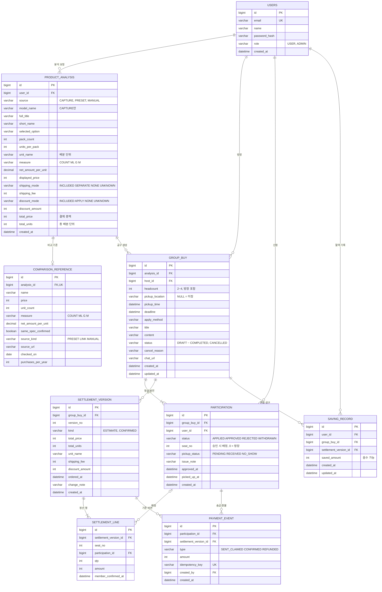

# ERD

긱스플리터: 생필품 공동구매 서비스의 데이터 구조입니다. [기능정의서 v1.1](./GigSplitter-PRD-v1.1.md)의 P0·P1 기능(F-01 ~ F-09, F-11 ~ F-20)에 맞춰 테이블 9개로 구성했습니다.

- **P0 (아이디어톤 시연)** 은 로그인과 DB 없이 동작합니다. 화면의 입력값이 `product_analysis`, `comparison_reference`, `group_buy`의 컬럼과 같은 이름·의미를 갖도록 맞췄습니다.
- **P1 (운영 MVP)** 부터 아래 테이블에 저장합니다. 참여 승인, 정산 버전, 송금·환불, 수령, 저금통은 P1 기능입니다.



## 테이블

- `users` — 사용자 계정 (P1 공통)
  - 이메일 중복 불가, 비밀번호는 해시로만 저장
  - P0 방문자는 계정 없이 사용
- `product_analysis` — 사용자가 확인한 대용량 상품 1건 (F-01, F-02, F-11)
  - Gemini 추출 필드(`fullTitle` ~ `discountAmount`)를 사용자 확인 후 저장
  - 미확인 숫자는 `NULL`
  - `total_units = pack_count × units_per_pack`(배분 단위), 비교용 환산량은 `total_units × net_amount_per_unit`
  - 원본 이미지는 저장하지 않음
- `comparison_reference` — 소용량 비교 기준 (F-03, F-12)
  - 분석 1건당 0~1행
  - 없으면 정산만 하고 절감 지표는 보류
  - 출처(`PRESET`/`LINK`/`MANUAL`)와 확인일을 함께 저장
- `group_buy` — 공구 (모집글 포함) (F-05, F-06, F-15, F-19)
  - 인원은 방장 포함 2~4명
  - 수령 장소·마감은 `NULL`이면 미정으로 표시
  - 상태는 아래 "공구 상태" 참고
- `participation` — 참여 신청·승인과 수령 기록 (F-15, F-18)
  - `(group_buy_id, user_id)` 한 쌍당 1행
  - 방장도 `seat_no = 0`, `APPROVED`로 1행
  - 승인될 때만 `seat_no`를 받음
  - `(group_buy_id, seat_no)` 중복 불가
- `settlement_version` — 정산 버전 (불변 스냅샷) (F-04, F-16)
  - 계산에 쓴 총액·수량·단위를 그대로 보관
  - 금액이나 인원이 바뀌면 덮어쓰지 않고 `version_no`를 올려 새 행을 만듦
- `settlement_line` — 버전별 자리 한 줄 (F-04, F-07, F-16)
  - `(settlement_version_id, seat_no)` 중복 불가
  - 모집 전 예상 버전은 `participation_id`가 `NULL`일 수 있음
  - 참여자 재확인 시각을 기록
- `payment_event` — 외부 송금·환불 이력 (F-17)
  - 앱은 송금하지 않고 기록만 함
  - `idempotency_key`가 중복 불가라 같은 클릭이 두 번 기록되지 않음
  - 기존 이벤트는 수정하지 않고 환불도 새 이벤트로 추가
- `saving_record` — 방어한 싱글세 저금통 (F-08)
  - `(user_id, group_buy_id)` 한 쌍당 1행
  - 완료 공구 중 비교 기준이 있는 건만 기록
  - 환불·정정 시 같은 행을 갱신하고 기준 버전을 바꿈

## 계산 규칙

기능정의서 v1.1 4장의 산식을 따릅니다. 모든 금액은 원 단위 정수로 계산합니다.

- **결제 총액** `total_price = displayed_price + (SEPARATE이면 shipping_fee) − (APPLY이면 discount_amount)`. 이미 반영된 배송비·할인(`INCLUDED`)은 다시 더하거나 빼지 않습니다.
- **수량 분배**: 공구원은 `⌊total_units ÷ N⌋`, 방장은 그 값에 나머지를 더함. 한 명이라도 1단위를 못 받으면 자동 분배하지 않고 인원을 줄이도록 안내합니다.
- **부담금**: 각자 `⌊total_price × 개인 qty ÷ total_units⌋`에서 시작해, 남는 원을 나머지가 큰 순서로 1원씩 배정합니다. 동률이면 방장, 그다음 `seat_no` 순서입니다. 한 버전의 `SUM(amount) = total_price`, `SUM(qty) = total_units`입니다.
  - 예) 30롤 · 17,701원 · 4명 → 방장 9롤 · 5,311원, 공구원 각 7롤 · 4,130원
- **단가·절감률**은 저장하지 않고 조회할 때 계산합니다. 대용량 단가는 `total_price ÷ 환산량`, 소용량 단가는 `price ÷ (unit_count × net_amount_per_unit)`입니다(`COUNT`이면 개수 그대로). 규격이 다르거나 `same_spec_confirmed = false`이면 절감 지표를 보류합니다.
- **개인 절감액** `= 개인 환산량 × 소용량 단가 − 개인 부담금`. 음수도 그대로 보여주고, 반올림은 표시할 때만 합니다.

## 공구 상태

DB에는 아래 7가지만 저장합니다. `FULL`(정원 참)과 남은 자리는 `APPROVED` 참여 수로 계산합니다.

| 상태 | 의미 | 다음 상태 |
| --- | --- | --- |
| `DRAFT` | 초안 | `RECRUITING`, `CANCELLED` |
| `RECRUITING` | 모집 중. 신청·승인 가능 | `CLOSED`, `CANCELLED` |
| `CLOSED` | 모집 마감. 주문 전이면 재모집 가능 | `RECRUITING`, `SETTLING`, `CANCELLED` |
| `SETTLING` | 실제 금액 확정(`CONFIRMED` 버전 생성), 입금 확인 | `RECEIVING`, `CANCELLED` |
| `RECEIVING` | 수령 안내·기록 | `COMPLETED`, `CANCELLED` |
| `COMPLETED` | 모든 유효 참여자의 입금·수령·정정이 해결됨. 저금통 기록 생성 | — |
| `CANCELLED` | 취소. `cancel_reason` 기록, 받은 돈은 `REFUNDED` 이벤트로 추적 | — |

## 동시 승인 처리

승인 트랜잭션 안에서 `SELECT ... FROM group_buy WHERE id = ? FOR UPDATE`로 공구를 먼저 잠급니다. 상태가 `RECRUITING`이고 `APPROVED` 수가 `headcount`보다 적을 때만, 비어 있는 가장 작은 `seat_no`를 주고 `APPROVED`로 바꿉니다. 두 사람을 동시에 승인해도 정원을 넘지 않고, `uq_part_seat`가 같은 자리 중복을 한 번 더 막습니다.

## SQL (MySQL 8 / H2)

```sql
CREATE TABLE users (
  id            BIGINT AUTO_INCREMENT PRIMARY KEY,
  email         VARCHAR(100) NOT NULL UNIQUE,
  name          VARCHAR(50)  NOT NULL,
  password_hash VARCHAR(255) NOT NULL,
  role          VARCHAR(20)  NOT NULL DEFAULT 'USER',
  created_at    DATETIME(6)  NOT NULL
);

CREATE TABLE product_analysis (
  id                  BIGINT AUTO_INCREMENT PRIMARY KEY,
  user_id             BIGINT        NOT NULL,
  source              VARCHAR(20)   NOT NULL,            -- CAPTURE | PRESET | MANUAL
  model_name          VARCHAR(50)   NULL,                -- 예: gemini-3.8-flash (CAPTURE만)
  full_title          VARCHAR(200)  NOT NULL,
  short_name          VARCHAR(60)   NULL,
  selected_option     VARCHAR(200)  NULL,
  pack_count          INT           NULL,
  units_per_pack      INT           NULL,
  unit_name           VARCHAR(10)   NOT NULL,            -- 배분 단위: 롤, 병, 개 ...
  measure             VARCHAR(10)   NOT NULL,            -- COUNT | ML | G | M (비교 단위)
  net_amount_per_unit DECIMAL(12,3) NULL,                -- 1단위의 용량·길이 (COUNT면 NULL)
  displayed_price     INT           NULL,
  shipping_mode       VARCHAR(20)   NOT NULL DEFAULT 'UNKNOWN',
  shipping_fee        INT           NULL,
  discount_mode       VARCHAR(20)   NOT NULL DEFAULT 'UNKNOWN',
  discount_amount     INT           NULL,
  total_price         INT           NOT NULL,            -- 결제 총액 (원)
  total_units         INT           NOT NULL,            -- 총 배분 단위
  created_at          DATETIME(6)   NOT NULL,
  CONSTRAINT fk_analysis_user FOREIGN KEY (user_id) REFERENCES users(id),
  CONSTRAINT ck_analysis_source CHECK (source IN ('CAPTURE','PRESET','MANUAL')),
  CONSTRAINT ck_analysis_measure CHECK (measure IN ('COUNT','ML','G','M')),
  CONSTRAINT ck_analysis_shipping CHECK (shipping_mode IN ('INCLUDED','SEPARATE','NONE','UNKNOWN')),
  CONSTRAINT ck_analysis_discount CHECK (discount_mode IN ('INCLUDED','APPLY','NONE','UNKNOWN')),
  CONSTRAINT ck_analysis_totals CHECK (total_price > 0 AND total_units > 0)
);

CREATE TABLE comparison_reference (
  id                  BIGINT AUTO_INCREMENT PRIMARY KEY,
  analysis_id         BIGINT        NOT NULL UNIQUE,
  name                VARCHAR(200)  NOT NULL,
  price               INT           NOT NULL,            -- 원
  unit_count          INT           NOT NULL,
  measure             VARCHAR(10)   NOT NULL,            -- COUNT | ML | G | M
  net_amount_per_unit DECIMAL(12,3) NULL,
  same_spec_confirmed BOOLEAN       NOT NULL DEFAULT FALSE,
  source_kind         VARCHAR(20)   NOT NULL,            -- PRESET | LINK | MANUAL
  source_url          VARCHAR(500)  NULL,
  checked_on          DATE          NULL,
  purchases_per_year  INT           NULL,
  CONSTRAINT fk_reference_analysis FOREIGN KEY (analysis_id) REFERENCES product_analysis(id),
  CONSTRAINT ck_reference_measure CHECK (measure IN ('COUNT','ML','G','M')),
  CONSTRAINT ck_reference_source CHECK (source_kind IN ('PRESET','LINK','MANUAL')),
  CONSTRAINT ck_reference_values CHECK (price > 0 AND unit_count > 0)
);

CREATE TABLE group_buy (
  id              BIGINT AUTO_INCREMENT PRIMARY KEY,
  analysis_id     BIGINT        NOT NULL,
  host_id         BIGINT        NOT NULL,
  headcount       INT           NOT NULL,                -- 방장 포함
  pickup_location VARCHAR(100)  NULL,                    -- NULL = 미정
  pickup_time     DATETIME(6)   NULL,
  deadline        DATETIME(6)   NULL,
  apply_method    VARCHAR(200)  NULL,
  title           VARCHAR(100)  NOT NULL,
  content         VARCHAR(2000) NOT NULL,
  status          VARCHAR(20)   NOT NULL DEFAULT 'DRAFT',
  cancel_reason   VARCHAR(200)  NULL,
  chat_url        VARCHAR(500)  NULL,
  created_at      DATETIME(6)   NOT NULL,
  updated_at      DATETIME(6)   NOT NULL,
  CONSTRAINT fk_group_buy_analysis FOREIGN KEY (analysis_id) REFERENCES product_analysis(id),
  CONSTRAINT fk_group_buy_host FOREIGN KEY (host_id) REFERENCES users(id),
  CONSTRAINT ck_group_buy_headcount CHECK (headcount BETWEEN 2 AND 4),
  CONSTRAINT ck_group_buy_status CHECK (status IN
    ('DRAFT','RECRUITING','CLOSED','SETTLING','RECEIVING','COMPLETED','CANCELLED'))
);

CREATE TABLE participation (
  id            BIGINT AUTO_INCREMENT PRIMARY KEY,
  group_buy_id  BIGINT       NOT NULL,
  user_id       BIGINT       NOT NULL,
  status        VARCHAR(20)  NOT NULL DEFAULT 'APPLIED', -- APPLIED | APPROVED | REJECTED | WITHDRAWN
  seat_no       INT          NULL,                       -- 승인 시 배정, 0 = 방장
  pickup_status VARCHAR(20)  NOT NULL DEFAULT 'PENDING', -- PENDING | RECEIVED | NO_SHOW
  issue_note    VARCHAR(200) NULL,                       -- 품절·부분 환불·노쇼 사유
  approved_at   DATETIME(6)  NULL,
  picked_up_at  DATETIME(6)  NULL,
  created_at    DATETIME(6)  NOT NULL,
  CONSTRAINT fk_part_group_buy FOREIGN KEY (group_buy_id) REFERENCES group_buy(id),
  CONSTRAINT fk_part_user FOREIGN KEY (user_id) REFERENCES users(id),
  CONSTRAINT uq_part_user UNIQUE (group_buy_id, user_id),
  CONSTRAINT uq_part_seat UNIQUE (group_buy_id, seat_no),
  CONSTRAINT ck_part_status CHECK (status IN ('APPLIED','APPROVED','REJECTED','WITHDRAWN')),
  CONSTRAINT ck_part_seat CHECK (seat_no BETWEEN 0 AND 3),
  CONSTRAINT ck_part_pickup CHECK (pickup_status IN ('PENDING','RECEIVED','NO_SHOW'))
);

CREATE TABLE settlement_version (
  id              BIGINT AUTO_INCREMENT PRIMARY KEY,
  group_buy_id    BIGINT       NOT NULL,
  version_no      INT          NOT NULL,
  kind            VARCHAR(20)  NOT NULL,                 -- ESTIMATE | CONFIRMED
  total_price     INT          NOT NULL,
  total_units     INT          NOT NULL,
  unit_name       VARCHAR(10)  NOT NULL,
  shipping_fee    INT          NULL,
  discount_amount INT          NULL,
  ordered_at      DATETIME(6)  NULL,
  change_note     VARCHAR(200) NULL,                     -- 이전 버전 대비 정정 사유
  created_at      DATETIME(6)  NOT NULL,
  CONSTRAINT fk_version_group_buy FOREIGN KEY (group_buy_id) REFERENCES group_buy(id),
  CONSTRAINT uq_version_no UNIQUE (group_buy_id, version_no),
  CONSTRAINT ck_version_kind CHECK (kind IN ('ESTIMATE','CONFIRMED')),
  CONSTRAINT ck_version_totals CHECK (total_price > 0 AND total_units > 0)
);

CREATE TABLE settlement_line (
  id                    BIGINT AUTO_INCREMENT PRIMARY KEY,
  settlement_version_id BIGINT      NOT NULL,
  seat_no               INT         NOT NULL,
  participation_id      BIGINT      NULL,
  qty                   INT         NOT NULL,
  amount                INT         NOT NULL,            -- 원
  member_confirmed_at   DATETIME(6) NULL,
  CONSTRAINT fk_line_version FOREIGN KEY (settlement_version_id) REFERENCES settlement_version(id),
  CONSTRAINT fk_line_participation FOREIGN KEY (participation_id) REFERENCES participation(id),
  CONSTRAINT uq_line_seat UNIQUE (settlement_version_id, seat_no),
  CONSTRAINT ck_line_values CHECK (seat_no BETWEEN 0 AND 3 AND qty > 0 AND amount >= 0)
);

CREATE TABLE payment_event (
  id                    BIGINT AUTO_INCREMENT PRIMARY KEY,
  participation_id      BIGINT      NOT NULL,
  settlement_version_id BIGINT      NOT NULL,
  type                  VARCHAR(20) NOT NULL,            -- SENT_CLAIMED | CONFIRMED | REFUNDED
  amount                INT         NOT NULL,            -- 원
  idempotency_key       VARCHAR(64) NOT NULL UNIQUE,
  created_by            BIGINT      NOT NULL,
  created_at            DATETIME(6) NOT NULL,
  CONSTRAINT fk_payment_participation FOREIGN KEY (participation_id) REFERENCES participation(id),
  CONSTRAINT fk_payment_version FOREIGN KEY (settlement_version_id) REFERENCES settlement_version(id),
  CONSTRAINT fk_payment_user FOREIGN KEY (created_by) REFERENCES users(id),
  CONSTRAINT ck_payment_type CHECK (type IN ('SENT_CLAIMED','CONFIRMED','REFUNDED')),
  CONSTRAINT ck_payment_amount CHECK (amount > 0)
);

CREATE TABLE saving_record (
  id                    BIGINT AUTO_INCREMENT PRIMARY KEY,
  user_id               BIGINT      NOT NULL,
  group_buy_id          BIGINT      NOT NULL,
  settlement_version_id BIGINT      NOT NULL,            -- 계산에 쓴 확정 버전
  saved_amount          INT         NOT NULL,            -- 원, 음수 가능
  created_at            DATETIME(6) NOT NULL,
  updated_at            DATETIME(6) NOT NULL,
  CONSTRAINT fk_saving_user FOREIGN KEY (user_id) REFERENCES users(id),
  CONSTRAINT fk_saving_group_buy FOREIGN KEY (group_buy_id) REFERENCES group_buy(id),
  CONSTRAINT fk_saving_version FOREIGN KEY (settlement_version_id) REFERENCES settlement_version(id),
  CONSTRAINT uq_saving_once UNIQUE (user_id, group_buy_id)
);
```

## 관련 문서

- [기능정의서 v1.1](./GigSplitter-PRD-v1.1.md)
- [기능정의서 v1.0 (PDF)](./GigSplitter-PRD-v1.0.pdf)
