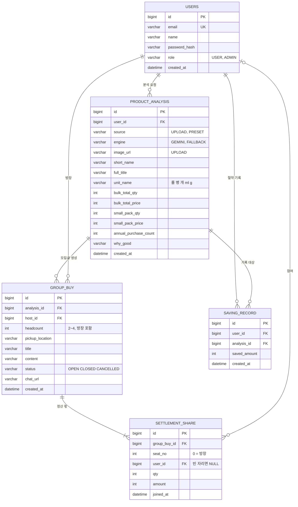

# ERD

긱스플리터: 생필품 공동구매 서비스 해커톤 프로토타입의 데이터 구조입니다. 캡스톤 프로젝트 두유팟의 모집글·참여 구조를 바탕으로, [기능정의서 (PRD v1.0)](./GigSplitter-PRD-v1.0.pdf)의 F-01 ~ F-09에 맞춰 테이블 5개로 구성했습니다.



## 테이블

| 테이블 | 역할 | 관련 기능 | 핵심 규칙 |
| --- | --- | --- | --- |
| `users` | 사용자 계정 | 공통 | 이메일 중복 불가, 비밀번호는 해시로만 저장 |
| `product_analysis` | 쇼핑몰 캡처 판독 결과 (상품 1건) | F-01, F-02, F-03, F-09 | Gemini JSON 응답(`shortName` ~ `whyGood`)을 컬럼에 그대로 저장. 프리셋은 `source = PRESET`, 폴백 연산 결과는 `engine = FALLBACK`. 금액은 원 단위 정수 |
| `group_buy` | 공구 모집글 | F-05, F-06, F-07 | 인원은 방장 포함 2~4명. 수령 장소 기본값은 `행복기숙사 1동 로비`. 생성된 에브리타임 모집글을 `title`·`content`에 저장 |
| `settlement_share` | 인원별 소분·정산표 한 줄 (자리 1개) | F-04, F-07 | 모집글 생성 시 `headcount`만큼 행을 미리 만듦. `seat_no = 0`은 방장. `(group_buy_id, seat_no)`와 `(group_buy_id, user_id)`는 각각 중복 불가 |
| `saving_record` | 방어한 싱글세 저금통 기록 | F-08 | `(user_id, analysis_id)` 한 쌍당 1행이라 같은 분석 건은 한 번만 기록됨. 누적 금액은 `SUM(saved_amount)` |

## 계산 규칙

기능정의서 4장의 산식을 따릅니다. 단가와 절감률은 저장하지 않고 `product_analysis` 값으로 그때그때 계산합니다.

- 대용량 단위 단가 `U_bulk = bulk_total_price / bulk_total_qty`
- 소용량 기준 단가 `U_small = small_pack_price / small_pack_qty`
- 단가 절감률(%) `= (U_small − U_bulk) / U_small × 100`

정산표(`settlement_share`)는 모집글을 만들 때 한 번 계산해 저장합니다. 인원 N은 `headcount`입니다.

- 공구원(`seat_no ≥ 1`): `qty = ⌊bulk_total_qty / N⌋`, `amount = ⌊bulk_total_price / N⌋`
- 방장(`seat_no = 0`): 위 값에 나머지 수량과 1원 단위 나머지 금액을 더함
- 한 모집글의 `SUM(amount)`는 항상 `bulk_total_price`와 같아야 합니다(QA: 정산 합계 무결성).
- 저금통에 기록하는 1인당 절약액 `saved_amount = (방장 qty × U_small) − 방장 amount`이고, 기록할 때의 값을 그대로 저장합니다.

## 상태 규칙

- DB에는 `OPEN`, `CLOSED`(방장 마감), `CANCELLED`(공구 취소)만 저장합니다.
- `FULL`(정원 참)은 조회할 때 `user_id`가 채워진 자리 수로 계산합니다.
- 남은 자리 수(모집글의 "N−1자리")도 `user_id IS NULL`인 자리 수로 계산합니다.

## 동시 참여 처리

참여 신청 트랜잭션 안에서 `SELECT ... FROM group_buy WHERE id = ? FOR UPDATE`로 모집글을 먼저 잠그고, `user_id`가 비어 있는 자리 중 `seat_no`가 가장 작은 자리에 사용자를 넣습니다. 두 사람이 마지막 자리를 동시에 눌러도 한 명만 들어가고, 참여 취소는 그 자리의 `user_id`를 다시 비웁니다.

## SQL (MySQL 8 / H2)

```sql
CREATE TABLE users (
  id            BIGINT AUTO_INCREMENT PRIMARY KEY,
  email         VARCHAR(100) NOT NULL UNIQUE,
  name          VARCHAR(50)  NOT NULL,
  password_hash VARCHAR(255) NOT NULL,
  role          VARCHAR(20)  NOT NULL DEFAULT 'USER',
  created_at    DATETIME(6)  NOT NULL
);

CREATE TABLE product_analysis (
  id                    BIGINT AUTO_INCREMENT PRIMARY KEY,
  user_id               BIGINT       NOT NULL,
  source                VARCHAR(20)  NOT NULL,           -- UPLOAD | PRESET
  engine                VARCHAR(20)  NOT NULL,           -- GEMINI(gemini-3.8-flash) | FALLBACK
  image_url             VARCHAR(500) NULL,               -- 업로드한 캡처 위치 (PRESET이면 NULL)
  short_name            VARCHAR(60)  NOT NULL,
  full_title            VARCHAR(200) NOT NULL,
  unit_name             VARCHAR(10)  NOT NULL,           -- 롤 | 병 | 개 | ml | g
  bulk_total_qty        INT          NOT NULL,
  bulk_total_price      INT          NOT NULL,           -- 원
  small_pack_qty        INT          NOT NULL,
  small_pack_price      INT          NOT NULL,           -- 원
  annual_purchase_count INT          NOT NULL,
  why_good              VARCHAR(200) NULL,
  created_at            DATETIME(6)  NOT NULL,
  CONSTRAINT fk_analysis_user FOREIGN KEY (user_id) REFERENCES users(id),
  CONSTRAINT ck_analysis_source CHECK (source IN ('UPLOAD','PRESET')),
  CONSTRAINT ck_analysis_engine CHECK (engine IN ('GEMINI','FALLBACK')),
  CONSTRAINT ck_analysis_values CHECK (bulk_total_qty > 0 AND bulk_total_price > 0
                                       AND small_pack_qty > 0 AND small_pack_price > 0)
);

CREATE TABLE group_buy (
  id              BIGINT AUTO_INCREMENT PRIMARY KEY,
  analysis_id     BIGINT        NOT NULL,
  host_id         BIGINT        NOT NULL,
  headcount       INT           NOT NULL,                -- 방장 포함
  pickup_location VARCHAR(100)  NOT NULL DEFAULT '행복기숙사 1동 로비',
  title           VARCHAR(100)  NOT NULL,
  content         VARCHAR(2000) NOT NULL,
  status          VARCHAR(20)   NOT NULL DEFAULT 'OPEN', -- OPEN | CLOSED | CANCELLED
  chat_url        VARCHAR(500)  NULL,                    -- 카카오톡 오픈채팅방 링크
  created_at      DATETIME(6)   NOT NULL,
  CONSTRAINT fk_group_buy_analysis FOREIGN KEY (analysis_id) REFERENCES product_analysis(id),
  CONSTRAINT fk_group_buy_host FOREIGN KEY (host_id) REFERENCES users(id),
  CONSTRAINT ck_group_buy_headcount CHECK (headcount BETWEEN 2 AND 4),
  CONSTRAINT ck_group_buy_status CHECK (status IN ('OPEN','CLOSED','CANCELLED'))
);

CREATE TABLE settlement_share (
  id           BIGINT AUTO_INCREMENT PRIMARY KEY,
  group_buy_id BIGINT      NOT NULL,
  seat_no      INT         NOT NULL,                     -- 0 = 방장
  user_id      BIGINT      NULL,                         -- 빈 자리면 NULL
  qty          INT         NOT NULL,
  amount       INT         NOT NULL,                     -- 원
  joined_at    DATETIME(6) NULL,
  CONSTRAINT fk_share_group_buy FOREIGN KEY (group_buy_id) REFERENCES group_buy(id),
  CONSTRAINT fk_share_user FOREIGN KEY (user_id) REFERENCES users(id),
  CONSTRAINT uq_share_seat UNIQUE (group_buy_id, seat_no),
  CONSTRAINT uq_share_user UNIQUE (group_buy_id, user_id),
  CONSTRAINT ck_share_seat CHECK (seat_no BETWEEN 0 AND 3)
);

CREATE TABLE saving_record (
  id           BIGINT AUTO_INCREMENT PRIMARY KEY,
  user_id      BIGINT      NOT NULL,
  analysis_id  BIGINT      NOT NULL,
  saved_amount INT         NOT NULL,                     -- 원
  created_at   DATETIME(6) NOT NULL,
  CONSTRAINT fk_saving_user FOREIGN KEY (user_id) REFERENCES users(id),
  CONSTRAINT fk_saving_analysis FOREIGN KEY (analysis_id) REFERENCES product_analysis(id),
  CONSTRAINT uq_saving_once UNIQUE (user_id, analysis_id)
);
```

## 관련 문서

- [기능정의서 (PRD v1.0, PDF)](./GigSplitter-PRD-v1.0.pdf)
