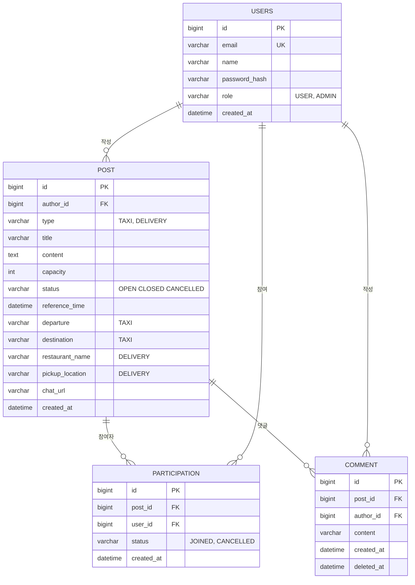

# ERD

택시·배달 합승 서비스 해커톤 프로토타입의 데이터 구조입니다. 캡스톤 프로젝트 두유팟의 DB 구조를 바탕으로, 시연에 필요한 테이블 4개로 줄였습니다.



## 테이블

| 테이블 | 역할 | 핵심 규칙 |
| --- | --- | --- |
| `users` | 사용자 계정 | 이메일 중복 불가, 비밀번호는 해시로만 저장 |
| `post` | 합승 모집글 (택시·배달 한 테이블) | 택시는 출발지·도착지, 배달은 가게·수령 장소만 채움. 정원은 작성자 포함 택시 2~4명, 배달 2~10명 |
| `participation` | 모집글 참여 | `(post_id, user_id)` 한 쌍당 1행. 취소 후 재참여는 같은 행의 상태만 변경 |
| `comment` | 모집글 댓글 | 1~500자. 삭제는 `deleted_at` 기록(행은 유지) |

## 상태 규칙

- DB에는 `OPEN`, `CLOSED`(작성자 마감), `CANCELLED`(일정 취소)만 저장합니다.
- `FULL`(정원 참)과 `FINISHED`(출발 시각 지남)는 조회할 때 참여 인원과 현재 시각으로 계산합니다. 시간이 지났다고 상태를 바꾸는 배치 작업이 필요 없습니다.
- 참여 마감은 출발 10분 전입니다.
- 댓글 응답의 `isPostAuthor`는 `post.author_id = comment.author_id`로 계산합니다.

## 동시 참여 처리

참여 신청 트랜잭션 안에서 `SELECT ... FROM post WHERE id = ? FOR UPDATE`로 모집글을 먼저 잠그고, `JOINED` 인원을 센 뒤 저장합니다. 두 사람이 마지막 자리를 동시에 눌러도 한 명만 들어갑니다.

## SQL (MySQL 8 / H2)

```sql
CREATE TABLE users (
  id            BIGINT AUTO_INCREMENT PRIMARY KEY,
  email         VARCHAR(100) NOT NULL UNIQUE,
  name          VARCHAR(50)  NOT NULL,
  password_hash VARCHAR(255) NOT NULL,
  role          VARCHAR(20)  NOT NULL DEFAULT 'USER',
  created_at    DATETIME(6)  NOT NULL
);

CREATE TABLE post (
  id              BIGINT AUTO_INCREMENT PRIMARY KEY,
  author_id       BIGINT        NOT NULL,
  type            VARCHAR(20)   NOT NULL,          -- TAXI | DELIVERY
  title           VARCHAR(60)   NOT NULL,
  content         VARCHAR(1000) NOT NULL,
  capacity        INT           NOT NULL,          -- 작성자 포함
  status          VARCHAR(20)   NOT NULL DEFAULT 'OPEN', -- OPEN | CLOSED | CANCELLED
  reference_time  DATETIME(6)   NOT NULL,          -- 출발·주문 시각 (UTC)
  departure       VARCHAR(100)  NULL,
  destination     VARCHAR(100)  NULL,
  restaurant_name VARCHAR(100)  NULL,
  pickup_location VARCHAR(100)  NULL,
  chat_url        VARCHAR(500)  NULL,
  created_at      DATETIME(6)   NOT NULL,
  CONSTRAINT fk_post_author FOREIGN KEY (author_id) REFERENCES users(id),
  CONSTRAINT ck_post_type CHECK (type IN ('TAXI','DELIVERY')),
  CONSTRAINT ck_post_capacity CHECK (capacity BETWEEN 2 AND 10)
);

CREATE TABLE participation (
  id         BIGINT AUTO_INCREMENT PRIMARY KEY,
  post_id    BIGINT      NOT NULL,
  user_id    BIGINT      NOT NULL,
  status     VARCHAR(20) NOT NULL DEFAULT 'JOINED', -- JOINED | CANCELLED
  created_at DATETIME(6) NOT NULL,
  CONSTRAINT fk_part_post FOREIGN KEY (post_id) REFERENCES post(id),
  CONSTRAINT fk_part_user FOREIGN KEY (user_id) REFERENCES users(id),
  CONSTRAINT uq_part_post_user UNIQUE (post_id, user_id)
);

CREATE TABLE comment (
  id         BIGINT AUTO_INCREMENT PRIMARY KEY,
  post_id    BIGINT       NOT NULL,
  author_id  BIGINT       NOT NULL,
  content    VARCHAR(500) NOT NULL,
  created_at DATETIME(6)  NOT NULL,
  deleted_at DATETIME(6)  NULL,
  CONSTRAINT fk_comment_post FOREIGN KEY (post_id) REFERENCES post(id),
  CONSTRAINT fk_comment_author FOREIGN KEY (author_id) REFERENCES users(id)
);
CREATE INDEX ix_comment_post ON comment (post_id, created_at, id);
```

## 관련 문서

- [기능정의서 (PRD v1.0, PDF)](./GigSplitter-PRD-v1.0.pdf)
